# Signature Extractor

A simple REST API that removes the white background from a scanned or photographed signature and makes it transparent. The resulting PNG can be embedded directly into online documents such as PDFs, Word files, or web pages.

## How it works

1. Upload an image (JPG or PNG) containing a signature via the `/signatures/extraction` endpoint.
2. The API detects the signature area, crops it, and converts the white background to a transparent alpha channel.
3. A PNG image with a transparent background is returned, ready to be inserted into any document.

## Running locally

### Prerequisites

- Python 3.10+
- The system packages `ffmpeg`, `libsm6`, and `libxext6` (required by OpenCV)

```bash
# Install system dependencies (Debian/Ubuntu)
sudo apt-get update && sudo apt-get install ffmpeg libsm6 libxext6 -y

# Install Python dependencies
pip install -r requirements.txt

# Start the development server
python main.py
```

The API will be available at `http://localhost:8000`. Open `http://localhost:8000/docs` in your browser to access the interactive Swagger UI.

## Running with Docker (recommended)

Docker is the easiest and most reliable way to run this project — it handles all system and Python dependencies automatically.

```bash
# Build the image
docker build -t signature-extractor .

# Run the container
docker run -d --name signature-extractor -p 80:80 signature-extractor
```

The API will be available at `http://localhost/docs`.

To stop and remove the container:

```bash
docker stop signature-extractor && docker rm signature-extractor
```

## API usage

| Method | Endpoint                 | Description                                    |
| ------ | ------------------------ | ---------------------------------------------- |
| `GET`  | `/`                      | Redirects to the Swagger UI                    |
| `POST` | `/signatures/extraction` | Accepts an image and returns a transparent PNG |

### Example with `curl`

```bash
curl -X POST "http://localhost/signatures/extraction" \
  -H "accept: image/png" \
  -F "file=@signature.jpg" \
  --output signature_transparent.png
```

## Sample results

The table below shows each sample input alongside the extracted transparent-background output.

> **Image source & license notice**
> All sample images were sourced from Freepik:
> [Hand-drawn signature element — freepik.com](https://www.freepik.com/free-vector/hand-drawn-signature-element_73934051.htm#fromView=search&page=1&position=5&uuid=96566565-5023-45f9-87a6-1f87be841638&query=Personal+signatur)
> These images are provided **only** as demonstration material. Their license belongs to Freepik and their respective authors — it is not covered by this project's license. Users who wish to use these images must review and comply with [Freepik's licensing terms](https://www.freepikcompany.com/legal#nav-freepik-license) independently.

| #   |                          Original (raw)                           |                            Extracted (transparent)                            |
| --- | :---------------------------------------------------------------: | :---------------------------------------------------------------------------: |
| 1   | 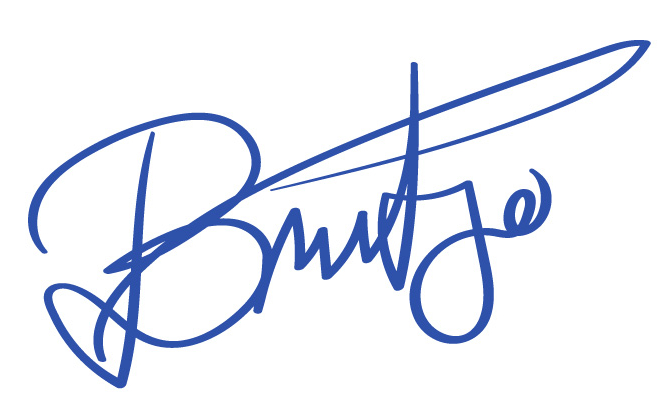 | 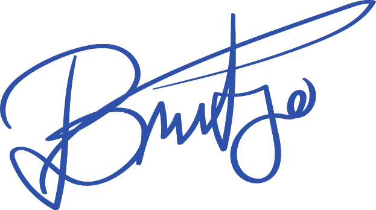 |
| 2   | 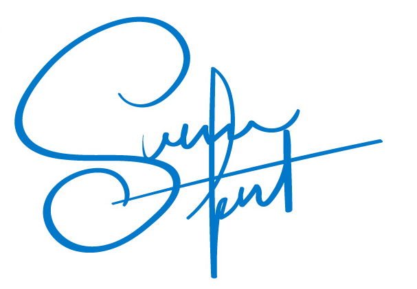 | 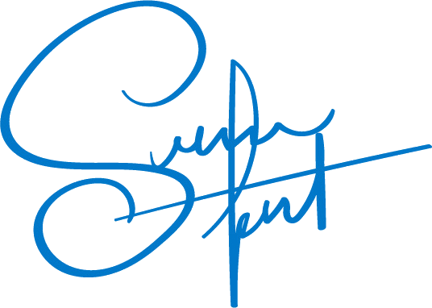 |
| 3   | 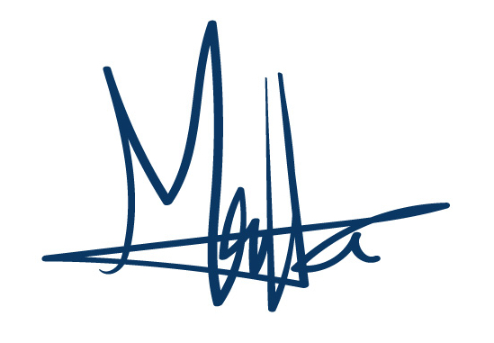 | 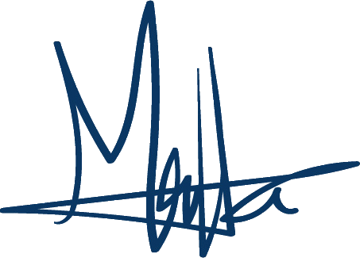 |
| 4   | 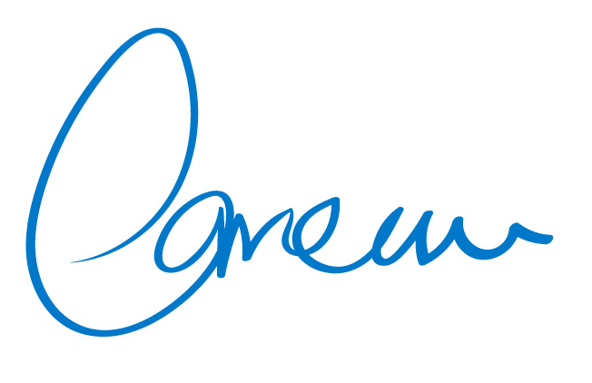 | 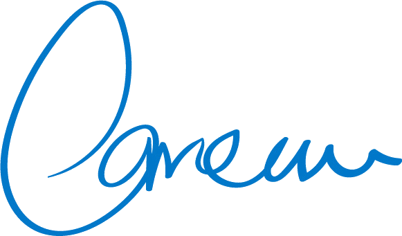 |
| 5   |  |  |
| 6   | 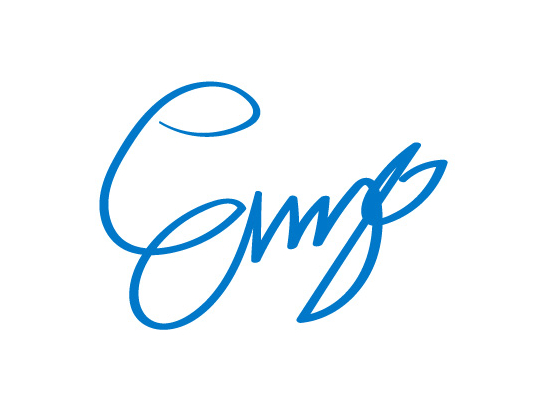 | 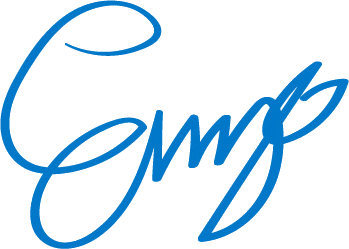 |
| 7   | 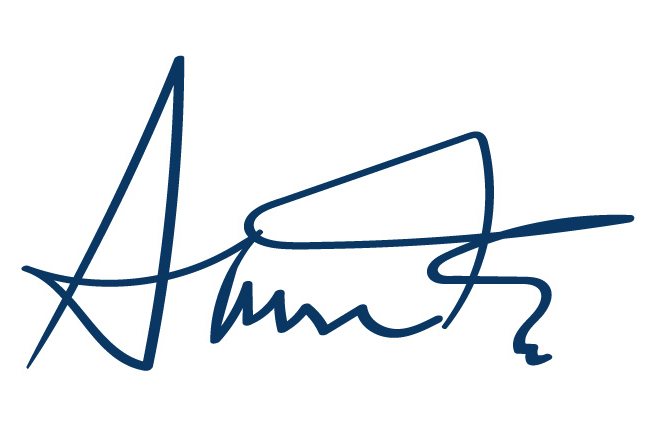 | 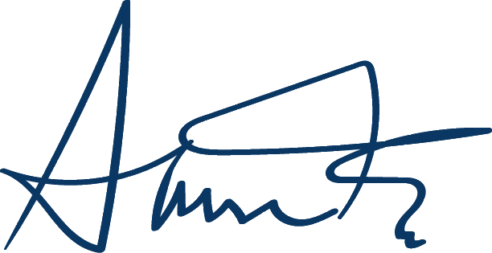 |
| 8   | 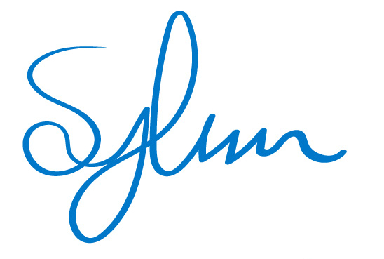 | 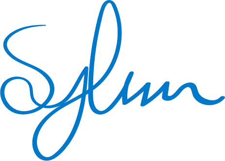 |
| 9   | 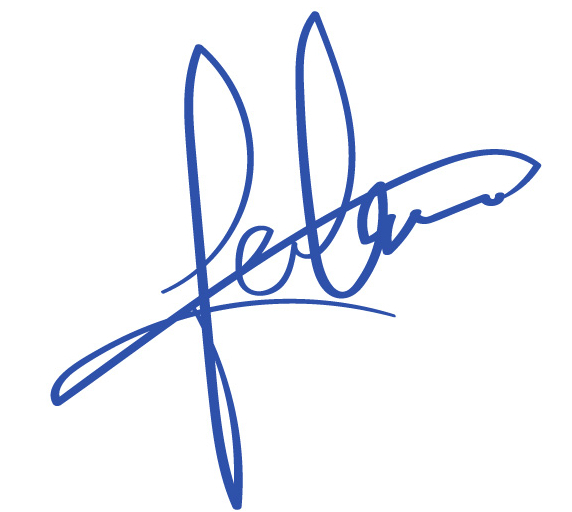 | 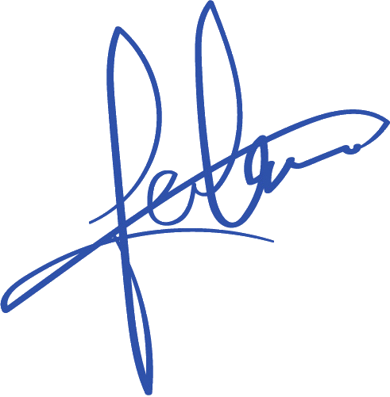 |
| 10  | 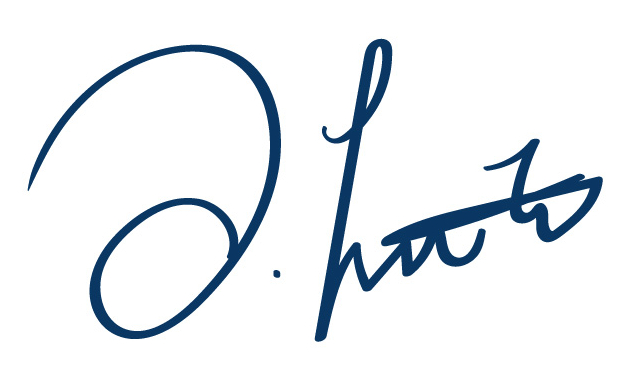 | 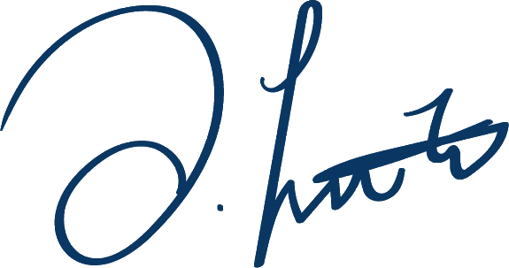 |
| 11  | 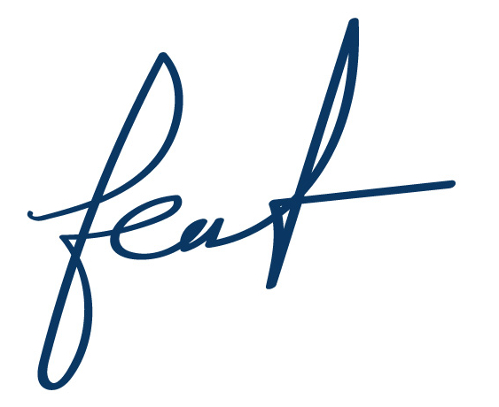 | 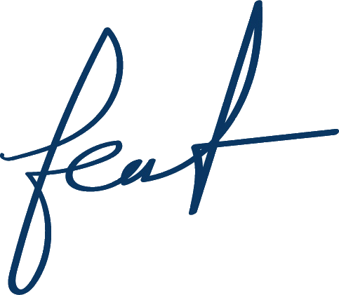 |
| 12  | 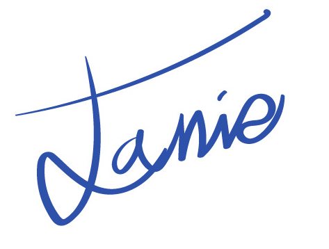 | 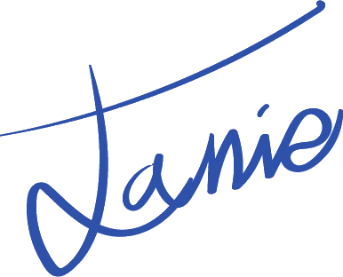 |

## License

See [LICENSE.md](LICENSE.md) for details.
